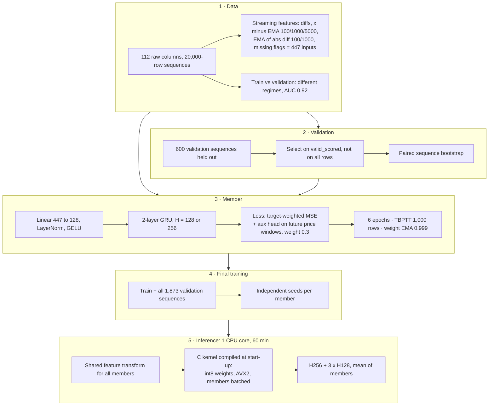

# Wunder Fund Alfa Connectome: my solution

- **Author:** [@KushnerykPavel](https://github.com/KushnerykPavel)
- **Result:** best public leaderboard 0.65767 (official baseline 0.59353).
- **Competition:** streaming prediction of two price-movement indicators from order books of two instruments, scored by a
  global weighted Pearson correlation; inference on 1 CPU core in 60 minutes for 39.4 million rows.

This is a write-up, not a code release. Snippets are simplified sketches of the parts I think are useful; they show the
idea, not the exact implementation.

## Contents

1. [The task in one paragraph](#1-the-task-in-one-paragraph)
   - [Pipeline at a glance](#pipeline-at-a-glance)
2. [What the data showed](#2-what-the-data-showed)
3. [Validation](#3-validation)
4. [The base model](#4-the-base-model)
5. [Data scale and the validation period](#5-data-scale-and-the-validation-period)
6. [Ensembles and where they saturate](#6-ensembles-and-where-they-saturate)
7. [The C kernel: fitting more models into 60 minutes](#7-the-c-kernel-fitting-more-models-into-60-minutes)
8. [The last real gain: an input projection](#8-the-last-real-gain-an-input-projection)
9. [What did not work](#9-what-did-not-work)
10. [Final selection and where the score came from](#10-final-selection-and-where-the-score-came-from)
11. [References](#references)

---

## 1. The task in one paragraph

Each sequence is 20,000 consecutive moments of two instruments, `i0` and `i1`: 11 bid and 11 ask "price-like" and
"volume-like" columns per instrument, 4 trade-price and 4 trade-volume columns per instrument, and 8 additional columns
`a0`-`a7` (112 inputs). The first 99 rows are warm-up. On every later row the model outputs `t0` and `t1`, two undisclosed
indicators of the future price movement of `i0`. Only a hidden subset of rows (`is_scored`) counts. The metric is the
weighted Pearson correlation per target (weights = |target|, both clipped to [-2, 2]), pooled over all scored rows of all
sequences, averaged over the two targets. Train: 10,607 sequences; validation: 1,873 with the scored mask; public test:
1,970, streamed row by row. State must be reset between sequences. The time limit works out to about 91 µs per row for
everything, including the Python callback.

## Pipeline at a glance



## 2. What the data showed

### 2.1 Train and validation are different regimes

A classifier on simple per-sequence input statistics separates train from validation at AUC 0.92-0.93, while two halves of
the same file are indistinguishable (AUC 0.50-0.53). Validation has a lower target spread (std 0.82 vs 0.92), more frequent
`i0` price moves (28 % vs 17 % of rows), lower `a2`/`a3` and more missing `a7`. The organisers later confirmed that the data
is split in time: train, then validation, then public test, then private test. So validation is the most test-like data
available, and every final model was trained on it (section 5).

### 2.2 Price columns move as a block

All 11 bid price columns change on exactly the same rows, and likewise all ask columns and volumes. Within-row price order is
only partly stable, and the index of a column is an identifier, not a depth level. Pairing price and volume per level from
co-occurrence did not work, so classical per-level order-flow imbalance [8, 9] was not applicable. I treated the book as
block-level signals.

### 2.3 Scored rows are a distinct state

On validation, `is_scored` covers 9.2 % of required rows, and the same model scores **0.692 on scored rows vs 0.516 on all
rows**. Scored rows have larger |t| (median 0.66 vs 0.48), more `i1` price changes, and different `a2`-`a4` levels. They come
in bursts, usually 1-2 rows apart. A boosted classifier predicts the mask from causal row features at AUC 0.87, mostly from
`a3`. A ridge proxy gained +0.012 on scored rows by up-weighting labelled scored rows, but in the GRU the same weighting gave
nothing on the board (section 9).

### 2.4 What the model relies on

Permutation importance (whole column groups swapped between sequences, row order kept) of a 2-layer GRU, drop in score:

| Group | Drop |
|---|---|
| `i0` volumes | 0.152 |
| `i0` prices | 0.063 |
| x − EMA(5000) block | 0.021 |
| `i0`, `i1` trade volumes | 0.012 each |
| x − EMA(100) block | 0.011 |
| `i1` volumes / prices, trade prices | 0.003-0.005 |
| `a0`-`a7` | ≤ 0.0014 each |

The long EMA spans matter: span 5000 is the third-largest block. Raw `i1` inputs helped a ridge model by +0.005-0.007, while
EMA features of `i1` added nothing, so only `i0` gets EMA features.

### 2.5 Targets

`corr(t0, t1) = −0.73`. The target autocorrelation is 0.97 at lag 1, 0.50 at lag 100 and 0.07 at lag 1,000: a smooth quantity
with 100-300 rows of memory. Future `i0` price columns over the next ~100 rows explain about 40 % of `t0` variance, which is
what the auxiliary head in section 4 uses.

## 3. Validation

- **Holdout.** 600 random validation sequences (seed 42) held out; models for screens train on train + the other 1,273
  validation sequences (`tv`). Each screen reports three views: `valid_scored` (scored rows of the holdout), `valid_all` (all
  rows of the holdout) and `holdout_all` (1,000 held-out train sequences).
- **Paired sequence bootstrap.** Single-model 95 % CIs are about ±0.02, so only paired differences are readable. Per-sequence
  sufficient statistics make a 1,000-resample bootstrap cheap:

```python
# Per sequence: sums of w, wy, wp, wy^2, wp^2, wyp on scored rows (w = |clip(y)|). One resample = weighted sum of rows.
def wp_from_stats(S):                       # S: [6] summed statistics
    w, wy, wp, wyy, wpp, wyp = S
    cov = wyp - wy * wp / w
    return cov / np.sqrt((wyy - wy**2 / w) * (wpp - wp**2 / w))

def paired_boot(Sa, Sb, n=1000, rng=np.random.default_rng(0)):   # Sa, Sb: [n_seq, 6] for models a and b
    d = []
    for _ in range(n):
        c = np.bincount(rng.integers(0, len(Sa), len(Sa)), minlength=len(Sa))
        d.append(wp_from_stats(c @ Sa) - wp_from_stats(c @ Sb))
    return np.percentile(d, [2.5, 97.5]), np.mean(np.array(d) > 0)
```

- **What tracked the board.** The public score followed `valid_scored`, not the mean of the three views. A recipe with +0.005
  on `holdout_all` and only +0.0014 on `valid_scored` scored no better on the board than a variant with no holdout gain. After that, every decision used
  `valid_scored`.
- **Noise floors.** Seed noise about 0.0005-0.001 on `valid_scored`; two independent copies of the same 4-member ensemble
  differ by about 0.0003 on public. I stopped reading public differences under ~0.0005 as signal.
- **The gap.** Public ≈ `valid_scored` − 0.039 for my models, against 0.026-0.029 that other participants reported. Holdout
  gains transferred to the board at roughly a quarter or less.

## 4. The base model

All members are small 2-layer GRUs [1] trained on full 20,000-row sequences with truncated BPTT [2] in 1,000-row chunks, state
carried through the warm-up rows. What survived, in the order I found it:

| Change | Gain | Note |
|---|---|---|
| Streaming features (below) + \|y\|-weighted MSE | +0.025 valid (paired CI [+0.022, +0.027]) | with more data, same run |
| Random length of the first TBPTT chunk (`chunk_offset`) | +0.001 | free |
| Weight EMA [3], decay 0.999 | +0.0015 valid, +0.001 public | better than raw weights at every epoch |
| 6 epochs instead of 12 | +0.006 valid_all | validation peaks at epochs 4-6 |
| Auxiliary head on future price windows, weight 0.3 | +0.0014 valid_scored | training only, dropped at export |
| Input projection Linear → LayerNorm → GELU, width 128 | +0.0017 valid_scored, +0.0033 on a second seed | section 8 |

### 4.1 Features

Inputs are computed causally, one row at a time, with a constant-size state:

- the 112 raw columns and their first differences;
- `a5`-`a7` sentinel values zeroed, plus three missing-value flags;
- for the 44 `i0` price and volume columns: `x − EMA_s(x)` for spans 100, 1,000 and 5,000, and `EMA_s(|Δx|)` for spans 100 and
  1,000, bias-corrected at the start of a sequence.

That gives 447 inputs. In training, a block-wise closed-form scan computes the EMAs over a 1,000-row chunk, so the training
path and the one-row inference path give the same numbers.

```python
def ema_scan(x, m0, decay, block=64):
    """m_t = decay * m_{t-1} + (1 - decay) * x_t over x [B, T, S]: closed form inside blocks, carry between blocks."""
    k = torch.arange(block)
    lag = (k[:, None] - k[None, :])[..., None]
    kernel = torch.where(lag >= 0, decay ** lag.clamp_min(0), 0.0)            # [K, K, S] lower-triangular decay
    xb = pad_to_blocks(x, block)                                               # [B, n_blocks, K, S]
    local = (1 - decay) * torch.einsum('ijs,bnjs->bnis', kernel, xb)
    out, carried = [], m0
    for n in range(xb.shape[1]):
        o = local[:, n] + decay ** (k[:, None] + 1) * carried
        out.append(o); carried = o[:, -1:]
    return torch.cat(out, 1)[:, :x.shape[1]]
```

### 4.2 Loss

Plain |y|-weighted MSE on clipped targets. Up to an affine map of the prediction, its minimiser maximises the global weighted
Pearson, so it is already aligned with the metric. A pure weighted-Pearson loss trained much worse (−0.045 after 3 epochs), and
a 0.6 / 0.4 mix of the two gave nothing.

```python
def wmse(pred, y):
    y = y.clamp(-2, 2)
    w = y.abs()                             # pred, y: [B, T, 2]
    return (w * (pred - y) ** 2).sum() / w.sum()
```

### 4.3 Auxiliary head on future price windows

A second linear head, trained only, predicts for 8 `i0` price columns the mean change and the standard deviation over the next
20, 100 and 500 rows, each standardised over the batch. These targets come from the inputs, not from the labels.
Label-derived auxiliary targets (smoothed future `t0`/`t1`, their signs) did not help; input-derived ones did.

```python
def future_window_targets(x, windows=(20, 100, 500)):
    """x [B, T, C] selected raw price columns -> per window: mean(x[t+1 .. t+w]) - x[t] and std(x[t+1 .. t+w])."""
    s1, s2 = prefix_sums(x), prefix_sums(x * x)
    t = torch.arange(x.shape[1]); parts = []
    for w in windows:
        end = (t + w).clamp(max=x.shape[1] - 1); n = (end - t).clamp_min(1)[None, :, None]
        mean = (s1[:, end + 1] - s1[:, t + 1]) / n
        var = ((s2[:, end + 1] - s2[:, t + 1]) / n - mean ** 2).clamp_min(0)
        parts += [mean - x, var.sqrt()]
    z = torch.cat(parts, -1)
    return (z - z.mean((0, 1))) / z.std((0, 1))

loss = wmse(head(h), y) + 0.3 * mse(aux_head(h), future_window_targets(x[..., FUTURE_COLS]))
```

## 5. Data scale and the validation period

Data was the dominant lever, ahead of any architecture change.

| Step | Data | Public |
|---|---|---|
| 2-layer GRU, CPU | 400 train sequences | 0.61635 |
| + features, wMSE | 1,300 train sequences | 0.63714 |
| GPU, train (minus 1,000 held out) + 1,273 validation sequences, 6 epochs | 10,880 | 0.64924 |
| Train + **all** 1,873 validation sequences, weight EMA | 11,480 | 0.65232 |

Adding validation sequences to training was worth +0.014 on `valid_all` and +0.005 on `valid_scored` on the holdout, and the
final retrain on all of validation added another +0.002 on the board (+0.001 more from the weight EMA). Final members cannot be scored on validation (they saw
it), so recipes were chosen on `tv` copies and the winners retrained on `tvall` with fixed epochs.

## 6. Ensembles and where they saturate

Members of one recipe with different seeds, averaged:

| Members | Public | Note |
|---|---|---|
| 1 | 0.65232 | |
| 2 | 0.65406 | +0.0017 |
| 3 | 0.65460 | +0.0005 |
| 3, auxiliary-head recipe | 0.65565 | new recipe, C kernel from here on |
| 6 (3 + 3 of a sibling recipe) | 0.65606 | +0.0004 |
| 9 (five recipes) | 0.65627 | |
| 3 × H128 + 1 × H384 | 0.65648 | best before the projection |

Residual correlations between members of all families were 0.987-0.997, and greedy per-member weights added at most +0.0003.
Mixing recipes (scored-row weights, sequence weights, hybrid loss) did not beat members of the single best recipe. One wider
member (H256 or H384) next to three H128 members was the only composition change worth keeping.

## 7. The C kernel: fitting more models into 60 minutes

The first ensembles ran through ONNX Runtime: three int8 members took 52-54 minutes, which capped the ensemble at three. Most
of the time went to many small operator calls, not to arithmetic. A small C kernel, compiled with gcc when the submission
starts, replaced it:

- one row per call: feature update, then each GRU layer for all members in one batched int8 matrix product;
- dynamically quantised int8 weights [4] (per-tensor scales, uint8 activations with a zero point, exactly as ONNX
  `MatMulInteger`), so its output matches the ONNX graph it replaced;
- the feature transform and the first-layer input product are shared by all members of a group; groups of different hidden
  size are mixed with their own weights;
- rows of activations that are exactly zero are skipped: most first differences are zero on a given row;
- AVX2 paths with a scalar fallback, and the build refuses to package a zip that would silently fall back to ONNX Runtime.

The same three members ran in **18m16s instead of 52m42s** (3.4x) with the same score, which turned the time budget from
three small members into roughly 200 µs per row. Final timing model on the scorer: minutes ≈ 5.05 + 0.277 × (µs per row on
my 1-core benchmark host).

```c
/* acc[n] = sum_k a[k] * w[k][n] for 64 outputs at a time. Weights are packed so that rows 2kp and 2kp+1 of 64 outputs
 * are 128 consecutive int8 values; a holds int16 activations (zero point already subtracted). */
for (int n0 = 0; n0 < N; n0 += 64) {
    __m256i c[8] = {0};                                    /* 8 x 8 int32 accumulators stay in registers */
    const int8_t *w = wp + (size_t)(n0 / 64) * Kp * 128;
    for (int kp = 0; kp < Kp; kp++, w += 128) {
        uint32_t pair = (uint16_t)a[2*kp] | ((uint32_t)(uint16_t)a[2*kp + 1] << 16);
        if (!pair) continue;                               /* most diff inputs are zero on a given row */
        __m256i av = _mm256_set1_epi32((int)pair);
        for (int j = 0; j < 8; j++)                        /* unrolled in the real code */
            c[j] = _mm256_add_epi32(c[j], _mm256_madd_epi16(av,
                       _mm256_cvtepi8_epi16(_mm_loadu_si128((const __m128i *)(w + 16 * j)))));
    }
    for (int j = 0; j < 8; j++) _mm256_storeu_si256((__m256i *)(acc + n0 + 8 * j), c[j]);
}
/* then out = acc * act_scale * w_scale + bias, and the GRU gates in float */
```

Some platform runs were 10-30 % slower than others for the same zip, and several participants reported timeouts late in the
competition. I kept every final at least 25 minutes under the limit.

## 8. The last real gain: an input projection

The GRU originally read the 447 features directly. A projection `Linear(447 → 128) → LayerNorm → GELU` in front of the first
GRU layer gained +0.0017 `valid_scored` on one seed (paired P = 0.97) and +0.0033 on a second. Widths 128-192 were equal; 64
and 256 slightly worse. The large input product becomes 447 → 128 instead of 447 → 3H. For the H256 ensemble that made inference faster (37 → 33 minutes); for three H128 members the float
LayerNorm and GELU cost about 2.5 minutes.

The C kernel got a projection path (float LayerNorm and exact-erf GELU between two int8 products). On the board:

| Ensemble | Without projection | With projection |
|---|---|---|
| 3 × H128 | 0.65565 (18m16s) | 0.65679 (20m42s) |
| H256 + 3 × H128 | 0.65638 (37m22s) | 0.65733 / **0.65767** (33-34 min) |
| H384 + 3 × H128 | 0.65630 (47m37s) | 0.65753 (44m17s) |

H384 was no better than H256. The two H256 + 3 × H128 builds use disjoint members (different seeds); their 0.0003 difference
is recipe noise.

## 9. What did not work

Each was tested against a matched control on the `tv` holdout, most at full scale on GPU:

- **Weighting:** loss weight ×3/×10/×30 on scored validation rows (ridge proxy +0.012, GRU ≈ 0 on the holdout, no gain on
  the board); per-sequence weights from the train-vs-validation classifier; regime-cluster weights; validation oversampled
  ×2/×3.
- **Augmentation:** input noise, column-group dropout, extra `a5`-`a7` missingness.
- **Losses and heads:** pure or mixed weighted Pearson, 4 averaged heads, DropConnect on recurrent weights [5], label-derived
  auxiliary targets, longer or wider auxiliary sets.
- **Capacity and memory:** H192-H512 single models (≤ +0.0011), 3 layers, TBPTT 2,000/4,000, 10-12 epochs, plain LSTM (level
  with the GRU).
- **Normalisation:** causal EMA input normalisation in the spirit of DAIN / RevIN [6, 7] (spans 1k/5k, −0.002 and +26 % inference cost); global standardisation of
  the 447 inputs with clipping (null).
- **Features:** held-price age, EMA features on trade columns, dropping `a` columns, a learnable EMA bank, random multi-scale
  EMA filter bank + ridge (0.646 vs 0.693).
- **Stacking and post-processing:** ridge stack or skip head, power or sign rescaling, smoothing, cross-target terms,
  per-sequence slope (an oracle slope would give +0.03, a slope fitted on the first half of a sequence loses 0.03).
- **Self-distillation** [10] with an in-sample teacher of the same size: monotonically worse with the teacher share (0.636 → 0.584).

Structural probes that came back negative: no row overlap between train and validation; explicit lagged inputs on the
residual lose 0.001-0.004 (the GRU already extracts linear history); a reconstructed delayed target as an extra input,
−0.001; a specialist for the hardest cluster of sequences (below) scored the same as the pooled model.

**The hard cluster.** Sequence-level clustering on early-row statistics is stable (ARI 0.97). One cluster (47 % of train,
37 % of validation) scores 0.405 against 0.74-0.80 for the others, for every model I trained. Pooled scores on the same
predictions range from 0.632 (train mix of clusters) to 0.682 (validation mix), so test composition explains much of the
validation-to-public gap.

## 10. Final selection and where the score came from

**Final selection** (three picks, best of three assumed): the two disjoint H256 + 3 × H128 projection ensembles (0.65767 in
34m22s, 0.65733 in 33m16s) and the 3 × H128 projection ensemble (0.65679 in 20m42s) as a hedge against a slow scoring host.

**Where the +0.064 over the baseline came from** (0.59353 → 0.65767; approximate, the steps overlap):

| Lever | Public gain | Share |
|---|---|---|
| CPU phase: own GRU training loop (0.5935 → 0.6164), then features, wMSE, 400 → 1,300 sequences | +0.044 | ~68 % |
| Full train on GPU + validation sequences, short training, weight EMA | +0.015 | ~24 % |
| Auxiliary head + ensembles made affordable by the C kernel | +0.004 | ~6 % |
| Input projection | +0.001 | ~2 % |

From 0.6523 (first model on all data) the work on the recipe, the ensembles and the kernel added +0.0054. Past 31 October,
everything except the projection was inside the noise.

## References

1. K. Cho et al. Learning phrase representations using RNN encoder-decoder for statistical machine translation. *EMNLP*, 2014.
2. R. J. Williams, J. Peng. An efficient gradient-based algorithm for on-line training of recurrent network trajectories. *Neural Computation*, 1990.
3. B. T. Polyak, A. B. Juditsky. Acceleration of stochastic approximation by averaging. *SIAM Journal on Control and Optimization*, 1992.
4. B. Jacob et al. 2017. arXiv:1712.05877 (int8 quantisation).
5. S. Merity, N. S. Keskar, R. Socher. 2017. arXiv:1708.02182 (AWD-LSTM, weight-dropped recurrent weights).
6. N. Passalis et al. 2019. arXiv:1902.07892 (DAIN, deep adaptive input normalisation).
7. T. Kim et al. *ICLR*, 2022 (RevIN, reversible instance normalisation).
8. R. Cont, A. Kukanov, S. Stoikov. The price impact of order book events. *Journal of Financial Econometrics*, 2014. arXiv:1011.6402.
9. K. Xu, M. D. Gould, S. D. Howison. 2019. arXiv:1907.06230 (multi-level order-flow imbalance).
10. G. Hinton, O. Vinyals, J. Dean. Distilling the knowledge in a neural network. arXiv:1503.02531, 2015.

---

*Validation numbers are weighted Pearson on the 600-sequence validation holdout unless the text names another set (full validation, CPU screens). Public numbers are marked. Snippets are simplified.*
